# Схема базы данных IssueTracker

PostgreSQL 15+ (используется `ON DELETE SET NULL (column)`). Миграции — `backend/internal/database/migrations`, применяются автоматически при старте API.

```mermaid
erDiagram
    users ||--o{ oauth_accounts : "входит через"
    users ||--o{ sessions : "сессии"
    users ||--o{ project_members : "состоит в"
    users ||--o{ projects : "владеет (owner_id)"
    projects ||--o{ project_members : "участники"
    projects ||--o{ project_invites : "приглашения"
    projects ||--o{ teams : "команды"
    projects ||--o{ issues : "задачи"
    projects ||--o{ documents : "документы"
    teams ||--o{ team_members : "состав"
    project_members ||--o{ team_members : "только участник проекта"
    project_members |o--o{ issues : "исполнитель (assignee)"
    users |o--o{ issues : "автор (reporter)"
    teams |o--o{ issues : "команда"
    issues ||--o{ issue_attachments : "картинки"
    issues ||--o{ issue_events : "история"
    issues |o--o{ documents : "связанная задача"
    issues |o--o{ issues : "родитель → подзадачи (parent_id)"
    projects ||--o{ sprints : "спринты"
    projects ||--o{ versions : "версии"
    sprints |o--o{ issues : "задачи спринта"
    versions |o--o{ issues : "исправлено в версии"
    issues ||--o{ worklogs : "списанное время"
    users |o--o{ worklogs : "кто списал"
    issues ||--o{ issue_comments : "комментарии"
    users |o--o{ issue_comments : "автор"
    issues ||--o{ issue_watchers : "наблюдатели"
    project_members ||--o{ issue_watchers : "только участник проекта"
    users ||--o{ notifications : "получатель"
    issues |o--o{ notifications : "о задаче"
    users ||--o| telegram_links : "чат Telegram"
    users ||--o{ telegram_link_codes : "коды привязки"

    users {
        uuid id PK
        citext email UK
        text name
        text job_title
        text about
        text password_hash "NULL — только OAuth"
        text avatar_url
        text avatar_key
        timestamptz created_at
        timestamptz updated_at
    }
    oauth_accounts {
        uuid id PK
        uuid user_id FK
        oauth_provider provider "google | github"
        text provider_user_id
        citext email
    }
    sessions {
        uuid id PK
        uuid user_id FK
        bytea refresh_token_hash UK "SHA-256"
        timestamptz expires_at
        timestamptz revoked_at
    }
    projects {
        uuid id PK
        varchar key UK "IT, WEB…"
        text name
        text description
        uuid owner_id FK
        int issue_counter "последний номер задачи"
    }
    project_members {
        uuid project_id PK,FK
        uuid user_id PK,FK
        project_role role "owner | admin | member | viewer"
        timestamptz joined_at
    }
    project_invites {
        uuid id PK
        uuid project_id FK
        citext email
        project_role role
        uuid invited_by FK
    }
    teams {
        uuid id PK
        uuid project_id FK
        text name "уникально в проекте"
        text description
    }
    team_members {
        uuid team_id PK,FK
        uuid user_id PK,FK
        uuid project_id FK
        text role_title "QA, Lead…"
    }
    issues {
        uuid id PK
        uuid project_id FK
        int number "ключ = KEY-number"
        text title
        text description
        issue_type type "task | bug | story"
        issue_status status "todo | in_progress | review | done"
        issue_priority priority "highest | high | medium | low"
        uuid assignee_id FK
        uuid reporter_id FK
        uuid team_id FK
        date start_date
        date due_date
        smallint points
        timestamptz completed_at
        uuid parent_id FK "подзадача чего"
        uuid sprint_id FK "NULL — бэклог"
        uuid fix_version_id FK
        int estimate_minutes "оценка времени"
    }
    sprints {
        uuid id PK
        uuid project_id FK
        text name
        text goal
        sprint_state state "planned | active | closed"
        date start_date
        date end_date
        timestamptz closed_at
    }
    versions {
        uuid id PK
        uuid project_id FK
        text name "уникально в проекте"
        text description
        date release_date "плановая"
        timestamptz released_at "NULL — не выпущена"
    }
    worklogs {
        uuid id PK
        uuid issue_id FK
        uuid user_id FK
        int minutes "1–1440"
        date work_date
        text note
    }
    issue_comments {
        uuid id PK
        uuid issue_id FK
        uuid author_id FK
        text body "упоминание: @[Имя](user:uuid)"
        timestamptz created_at
        timestamptz updated_at
    }
    issue_watchers {
        uuid issue_id PK,FK
        uuid user_id PK,FK
        uuid project_id FK
    }
    notifications {
        bigint id PK
        uuid user_id FK
        uuid project_id FK
        uuid issue_id FK
        uuid actor_id FK
        text kind "assigned | mentioned | commented | status"
        jsonb payload
        timestamptz read_at
    }
    telegram_links {
        uuid user_id PK,FK
        bigint chat_id UK
        text username
        boolean enabled
    }
    telegram_link_codes {
        text code PK
        uuid user_id FK
        timestamptz expires_at
    }
    issue_attachments {
        uuid id PK
        uuid issue_id FK
        text file_name
        text content_type
        bigint size_bytes
        text storage_key UK "ключ в S3"
    }
    issue_events {
        bigint id PK
        uuid issue_id FK
        uuid actor_id FK
        text kind
        jsonb changes
    }
    documents {
        uuid id PK
        uuid project_id FK
        doc_kind kind "file | link"
        text name
        doc_category category
        text url "для ссылки"
        text storage_key UK "для файла"
        bigint size_bytes
        uuid issue_id FK
        uuid uploaded_by FK
    }
```

## Связи и что происходит при удалении

| Связь | Тип | При удалении родителя |
|---|---|---|
| users → oauth_accounts, sessions | 1 : N | CASCADE — удаляются |
| users → projects (owner_id) | 1 : N | RESTRICT — нельзя удалить владельца проекта |
| projects ↔ users через **project_members** | M : N + роль | CASCADE с обеих сторон |
| projects → project_invites | 1 : N | CASCADE. При регистрации/входе с этим email приглашение превращается в членство |
| projects → teams | 1 : N | CASCADE |
| teams ↔ project_members через **team_members** | M : N + роль в команде | CASCADE. Составной FK `(project_id, user_id) → project_members`: исключили из проекта — пропал из всех команд |
| projects → issues | 1 : N | CASCADE |
| issues.assignee_id → project_members | N : 1 | SET NULL (assignee_id). Составной FK: исполнитель — только участник **этого** проекта |
| issues.team_id → teams | N : 1 | SET NULL (team_id). Составной FK: команда — только из этого проекта |
| issues.reporter_id → users | N : 1 | SET NULL |
| issues → issue_attachments, issue_events | 1 : N | CASCADE (файлы из S3 удаляет API) |
| projects → documents | 1 : N | CASCADE |
| documents.issue_id → issues | N : 1 | SET NULL (issue_id). Составной FK: задача — только из этого проекта |
| issues.parent_id → issues | N : 1 (дерево) | SET NULL (parent_id): удалили родителя — подзадачи становятся самостоятельными. Составной FK: родитель из того же проекта; цикл запрещает API, «сам себе родитель» — CHECK |
| projects → sprints, versions | 1 : N | CASCADE |
| issues.sprint_id → sprints | N : 1 | SET NULL (sprint_id): спринт удалили — задачи вернулись в бэклог |
| issues.fix_version_id → versions | N : 1 | SET NULL (fix_version_id) |
| issues → worklogs, issue_comments | 1 : N | CASCADE; автор (users) — SET NULL, запись остаётся |
| issues ↔ project_members через **issue_watchers** | M : N | CASCADE с обеих сторон: ушёл из проекта — перестал следить |
| users → notifications | 1 : N | CASCADE; задача или проект удалены — уведомления о них тоже |
| users → telegram_links | 1 : 0..1 | CASCADE; один чат — один аккаунт (`chat_id` UNIQUE) |

## Ограничения целостности

- `projects.key` — `^[A-Z][A-Z0-9]{1,9}$`, уникальный; номер задачи выдаётся атомарно `UPDATE projects SET issue_counter = issue_counter + 1 … RETURNING`.
- Ровно один владелец на проект — частичный уникальный индекс `project_members (project_id) WHERE role = 'owner'`.
- `issues`: `start_date <= due_date`, `points` 0–100, `UNIQUE (project_id, number)`.
- `documents`: файл — есть `storage_key`, нет `url`; ссылка — наоборот (CHECK).
- `teams`: название уникально в проекте без учёта регистра (`lower(name)`).
- `users.email`, `project_invites.email` — `citext`: регистр не важен.
- `sprints`: не больше одного активного спринта в проекте — частичный уникальный индекс `WHERE state = 'active'`; у активного спринта обязательны даты (CHECK).
- `versions`: название уникально в проекте без учёта регистра.
- `worklogs.minutes` — от 1 до 1440 (сутки) за одну запись.
- `telegram_link_codes` — одноразовые, живут 15 минут.

## Индексы

`issues (project_id, status)`, `issues (assignee_id)`, `issues (project_id, due_date)`, `issues USING gin (title gin_trgm_ops)` — поиск по названию, `documents (project_id, created_at DESC)`, `issue_events (issue_id, created_at)`, `sessions (user_id)`, `project_members (user_id)`, `issues (parent_id)`, `issues (sprint_id)`, `issues (fix_version_id)`, `worklogs (issue_id)`, `worklogs (user_id, work_date)`, `issue_comments (issue_id, created_at)`, `notifications (user_id, created_at DESC)` и частичный `notifications (user_id) WHERE read_at IS NULL` — быстрый счётчик непрочитанных.
